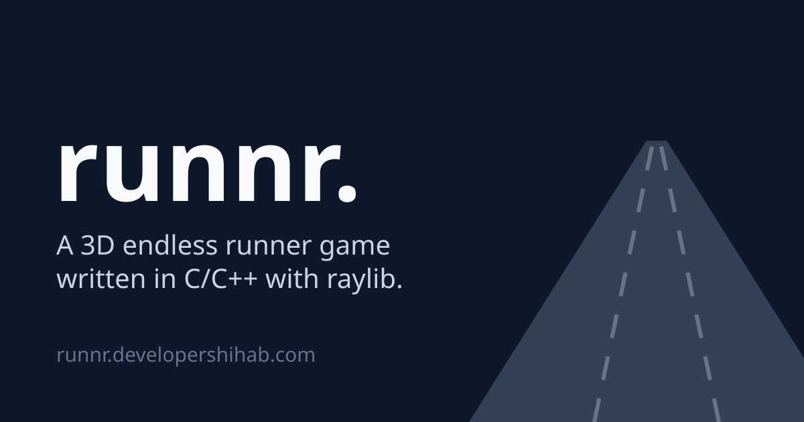

# runnr.

A 3D endless runner game written in C/C++ with raylib.

Obstacles come from a recycled object pool, and the game is compiled to WebAssembly with Emscripten so it can be played in the browser.

Play it at [runnr.developershihab.com](https://runnr.developershihab.com/).

[](https://runnr.developershihab.com/)

<!--toc:start-->

- [Getting started](#getting-started)
    - [Cloning](#cloning)
    - [Linux](#linux)
        - [Dependencies](#dependencies)
        - [Building](#building)
    - [Web](#web)
        - [Dependencies](#dependencies-1)
        - [Building](#building-1)
- [License](#license)

<!--toc:end-->

## Getting started

### Cloning

```sh
git clone https://github.com/mt-shihab26/runnr.git
cd runnr
git submodule update --init --recursive --depth 1 --single-branch
```

Keep `--single-branch`, without it raylib takes about 260 MB instead of about 54 MB.

### Linux

#### Dependencies

On Arch Linux:

```sh
sudo pacman -S --needed git premake make gcc bash
```

raylib is built from source along with the game, so it also needs the X11 and OpenGL headers:

```sh
sudo pacman -S --needed libx11 libxrandr libxinerama libxcursor libxi mesa
```

#### Building

```sh
scripts/linux/dev.sh       # build debug and run
scripts/linux/debug.sh     # build debug
scripts/linux/release.sh   # build release
scripts/linux/clean.sh     # remove generated build files
```

Binaries are written to `.build/linux-x86_64/bin/<config>/runnr`.

### Web

#### Dependencies

On Arch Linux, with librsvg and Noto Sans to render the share preview `scripts/web/preview.svg` to PNG:

```sh
sudo pacman -S --needed git premake make bash emscripten librsvg noto-fonts
```

#### Building

```sh
scripts/web/serve.sh     # build release, serve it and open it in the browser
scripts/web/release.sh   # build release
```

The page is written to `.build/web-wasm32/bin/release/runnr.html`. It must be served over http, as it can't load its files from disk. `serve.sh` serves it at [localhost:8080/runnr.html](http://localhost:8080/runnr.html) with `bunx http-server`.

## License

runnr. is released under the [MIT License](LICENSE).
